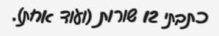
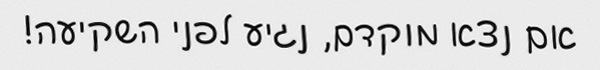

# `render-lines`: render given text lines with governed fonts

`hocrsyngen render-lines` renders lines that **the caller supplies** into single-line images. It writes logical-order labels and records provenance for every line. It is the entry point for rendered training lines, such as R9's born-digital Knesset text, that must use open-licence fonts with per-font provenance (decision 0018). Its output is synthetic, marked `synthetic: "rendered"` on every line, and never goes into an eval set.

It is separate from `generate`, which builds template pages and samples its own text. `render-lines` doesn't touch `generation_manifest.json` v1.

## Usage

```bash
hocrsyngen render-lines --input lines.jsonl --output out/ --seed 20261113 \
  [--font frank-ruhl-libre --font david-libre-regular ...] [--preset modern_print_scan_v1] \
  [--size-range 24 72 | --band-range 27 34 [--band-def otsu2pct|p5p95]] [--weight-range 400 400]
hocrsyngen render-lines --list-fonts [--preset handwriting_v1]
```

- **`--input`:** UTF-8 JSONL, one `{"id": ..., "text": ..., "group": ...}` per physical line, with text in logical order. `group` is optional, e.g. a sitting id. Ids must be filename-safe (`[A-Za-z0-9_.-]`, at most 200 characters) and unique.
- **Size:** give one of the two.
  - `--size-range`: font px, the default being 24–72.
  - `--band-range`: target ink-band px under `--band-def`. It is converted to a font size per face (and weight) by measuring a fixed calibration line, so every face lands in the same band on typical text. The first guess scales the band measured at 100 px. If the calibration line drawn at that size misses the target by more than 2 px, which happens on hinted static faces such as Cousine Bold, the nearby sizes are measured and the closest one is used. Every face before the office faces keeps its first guess, so its output is unchanged.
- **`--weight-range`:** sampled, then clipped to each variable face's weight axis. Static faces keep their own weight, recorded as `weight: null`.
- **Groups:** lines that share a `group` share face, size or band, and weight, so a sitting reads like one document. Degradation is still drawn per line.
- **Python:** `hocrsyngen.line_render.render_lines(lines, output, seed=..., fonts=..., preset=..., size_range=... | band_range=..., weight_range=...)` does the same and returns the summary. The CLI is the stable surface. Pin the commit you used.

## Handwriting-style lines

Choose `--preset handwriting_v1` to render with Gveret Levin and Playpen Sans Hebrew. The font registry enables them for this preset and records their pinned upstream sources, file hashes and SIL Open Font License 1.1 notices. The held-out font guard checks each font ID and file. Use `--font` to restrict the pool to one of these faces. [Gveret Levin source](https://github.com/AlefAlefAlef/gveret-levin/tree/b383a9c00863837b1b88b4d0365f43a304007dae) · [Playpen Sans Hebrew source](https://github.com/google/fonts/tree/8b0a1d0f5983c89bc2b93f1b5fb55f9e252744b5/ofl/playpensanshebrew)

The renderer shapes each full line in RTL, then applies seeded baseline wobble, slant, locally varying horizontal spacing and stroke thickness. Light blur, paper grain, ink contrast and compression simulate a scan. The existing `preset_params` field records the draws. The PNGs, logical-order labels and `hocrsyngen_line_render.v1` sidecar work with the same training lists.

The [four development samples](assets/handwriting-lines/) use project-authored prompts dedicated to the public domain under CC0 1.0. The sidecar identifies the font for each image. Reproduce them with seed 8421.

```bash
hocrsyngen render-lines --input docs/assets/handwriting-lines/prompts.jsonl \
  --output out/handwriting-dev --seed 8421 --preset handwriting_v1 --band-range 27 34
```





For a training batch, prepare JSONL with stable IDs from the approved plain `htext-cc0` corpus, then decontaminate it before rendering: drop reserved works with `reserved_works.py`, pre-filter lines against eval's official targets, and render only after eval's `check_train_overlap` reports CLEAN on the exact list. The handwriting evaluation set is real handwriting, so these text checks are what keep it held out. Pin that release, the renderer commit, dependency versions and seed. Queue bulk rendering remotely through the lead. Check `summary.json` for font coverage refusals and record the rendered line and font counts. If sharding, pin face assignments before partitioning and use `--font` per shard to preserve those assignments.

## Output

| File | Content |
|---|---|
| `lines/<id>.png` | greyscale line image |
| `lines/<id>.gt.txt` | the input text, NFC, whitespace-collapsed, logical order |
| `manifest.jsonl` | one `hocrsyngen_line_render.v1` record per line: `group`, `font_id`, `font` {id, file, sha256, license, license_file, variable_weight}, `size_px`, `size_mode`, `target_band_px`, `weight`, `ink_band_px`, `dark_density`, `preset`, `preset_params` (the values drawn for that line), `seed`, `line_seed`, `style_seed`, `synthetic: "rendered"`, `label_order: "logical"`, width and height |
| `summary.json` | lines in and rendered, `refused` (id, reason; per line, never silent), counts per font, number of groups, the preset definition, size or band range, weight range, seed, the font manifest's sha256 and the package version |

**Ink band.** Every line records two definitions, both measured on the final, degraded image.

- **`otsu2pct`, the default for `--band-def`:** `ink_band_px_otsu2pct` and `ink_band_frac_otsu2pct`.
  - This is the R9 face-stats definition (`tasks/r9-new-printed/face_stats/per_face_stats.py`, from r8c `measure.py`). Ink is a pixel at or below the line's Otsu threshold.
  - The band runs from the first to the last row with more than 2% ink, so ascenders, descenders, brackets and quotes are included.
  - The density is the ink share inside the band rows, times the first-to-last ink columns.
  - On 12 rendered lines it gives exactly the same band and density as `per_face_stats.measure()`.
- **`p5p95`:** `ink_band_px` and `dark_density`.
  - Dark is below the midpoint of the line's ink and paper grey.
  - The band is the rows between the 5th and 95th percentile of dark-pixel rows, about the letter body.

Band targeting fixes the font size from a typical calibration line. Each line's actual band then varies with its content, as on a real scan: a line with brackets, digits or quotes has a taller `otsu2pct` band than its target. Select on the recorded per-line band if you need a hard cut.

## Rules

- **Governed faces only.**
  - The manifest `data/synthetic/fonts/manifest.yaml` requires `line_render: true` for print presets and `handwriting_line_render: true` for `handwriting_v1`. Both require a `license` id, a `license_file` next to it and a `sha256`.
  - The renderer checks each font file against its sha256 and refuses any face that doesn't match or isn't listed.
  - Fifteen print faces are enabled, all OFL-1.1.
    - Alef, David Libre and Frank Ruhl Libre came with the package.
    - Noto Sans Hebrew, Noto Serif Hebrew, Assistant, Heebo, Rubik and Miriam Libre come from google/fonts at commit `3cb0866aebe5de40156f418a1750cb329e81ebdb`. Each file was checked against its git blob, each has its `OFL.txt` as `LICENSE-<Family>-OFL.txt`, and the source path is in the manifest notes.
    - **Office faces** (styles `office_sans`, `office_serif`, `office_mono`): Arimo, Tinos Regular and Bold, Cousine Regular and Bold, and Open Sans, from google/fonts at commit `7af0d90b4d532ffa4b041937b560c6df4e7b1e95`, each checked against its git blob. Arimo, Tinos and Cousine are metric-compatible stand-ins for Arial, Times New Roman and Courier New, which are proprietary and never used. google/fonts has no `OFL.txt` for Tinos at that commit, so its licence text comes from the upstream commit google/fonts pins (googlefonts/tinos `3b4482a`), also blob-checked.
  - Gveret Levin also serves the handwritten note templates in `generate`. Noto Rashi is used only for page generation.
  - **Coverage.** Every enabled print face has the 27 letters, the basic niqqud (U+05B0–05BC, 05C1, 05C2, 05C7), the digits and common punctuation, including ־ ׳ ״ – — (Open Sans without ׳ ״).
    - Te'amim: the two Noto faces, Arimo, Tinos and Cousine.
    - Rafe (U+05BF) is missing from Alef, Rubik, Miriam Libre and Open Sans.
    - Open Sans also lacks geresh and gershayim (U+05F3, U+05F4).
    - A line with a mark its face lacks is refused.
  - **Default weights.** Several variable faces default to a light instance (Assistant 200, Noto Sans Hebrew 100, Rubik 300). The default `--weight-range 400 400` renders them at regular weight.
- **Bidi** is resolved by Pillow's libraqm backend with an RTL base direction:
  - digit and Latin runs stay left to right;
  - paired brackets are mirrored.

  Without libraqm the renderer refuses to run. `tests/test_line_render.py` checks glyph order by template matching on lines with numbers, brackets, Latin and dates. It also has a negative control: a naively reversed line must fail the same check.
- **Coverage.** A line with a character its assigned face can't draw (the glyph would be `.notdef`) is refused and listed in `summary.json`. It is never rendered as a box.
- **Balance.** Faces are assigned through a seeded permutation of the sorted group keys, or line ids when there are no groups, so per-face counts differ by at most one.
- **Determinism.** A seeded permutation assigns faces over the full set of group or line IDs. Size and weight come from sha256(seed:group-or-line:style). Each line's jitter, degradation and grain use sha256(seed:id). In the same environment, matching face and seeds give identical renders.

## Presets

All presets work at line level. `modern_print_scan_v1` (light) is the default, and the strength is a parameter, so a training run can test it separately.

| Preset | blur σ | grain std | ink / paper grey | JPEG q | downsample | ink spread | rotation |
|---|---|---|---|---|---|---|---|
| `none` | 0 | 0 | 0 / 255 | none | 1.0 | 0 | 0 |
| `modern_print_scan_v1` (default) | 0–0.4 | 0–4 | 0–40 / 225–255 | 85–95 | 1.0 | 0 | ±0.2° |
| `modern_print_scan_v1_medium` | 0.2–0.7 | 2–8 | 10–60 / 200–245 | 70–90 | 0.7–1.0 | 0 | ±0.4° |
| `modern_print_scan_v1_small_inky` | 0.3–0.8 | 2–8 | 0–50 / 190–240 | 65–85 | 0.5–0.75 | 0–1 px | ±0.4° |
| `handwriting_v1` | 0.1–0.45 | 0.8–3 | 15–62 / 230–252 | 86–96 | 0.95–1.0 | fractional thinning or thickening | ±0.6° |

`modern_print_scan_v1_small_inky` aims at the small, inked rendering that hurt R8b on Brainin IA. R8c step 0 found that loss came from face shape at small size, not from noise. For the per-face question, set `--band-range` and `--weight-range` before you raise the preset.

— synth-gen[claude/claude-code#shay-macbook-m4]@heocr/opensource
