# Old-print Montefiore at native printed scale

Twenty Hebrew lines compare native gray-first glyph composition, classical seam smoothing and a distinct real TRAIN crop for each row. The matched references use different source parent pages. Glyphs are resized in gray before foreground classification, with a feathered ownership region around their antialiased edges.

The source letter-height target is 25 px. The source-derived line pitch is 52 px. The median stroke-to-height ratio is 0.174 in classical composites and 0.182 in real TRAIN lines. Full-frame ink cover is 0.130 and 0.136, respectively.

| Gray-first composite | Classical smoothing | Matched real crop |
| --- | --- | --- |
| 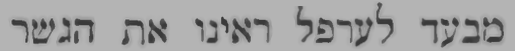 |  | 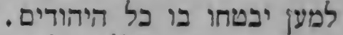 |
| 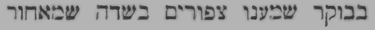 |  | 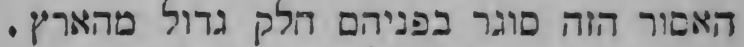 |
| 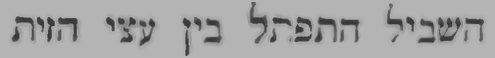 | 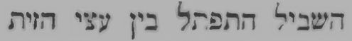 | 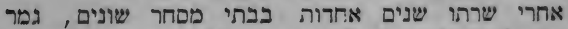 |
|  | 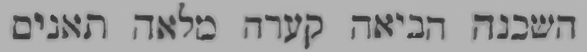 | 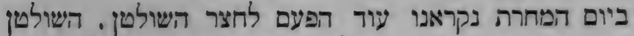 |
| 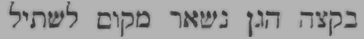 |  | 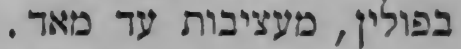 |
| 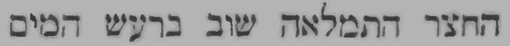 |  | 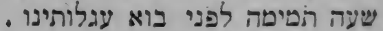 |
| 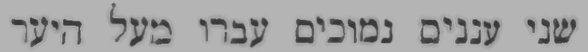 | 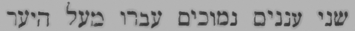 | 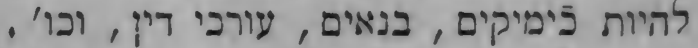 |
| 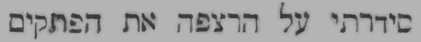 | 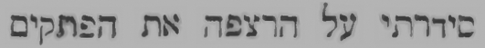 | 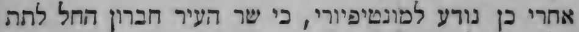 |
|  | 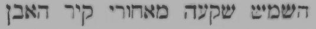 | 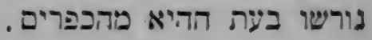 |
|  | 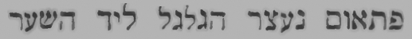 | 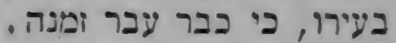 |
| 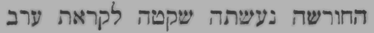 | 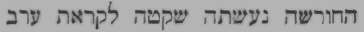 | 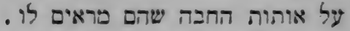 |
|  | 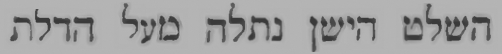 | 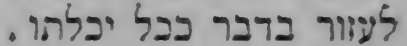 |
| 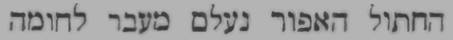 |  | 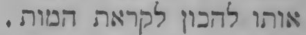 |
| 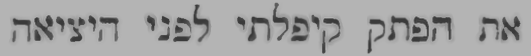 |  | 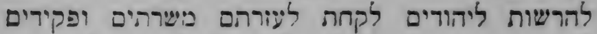 |
| 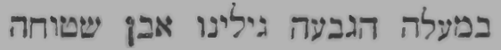 |  | 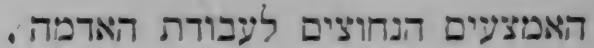 |
| 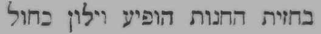 |  | 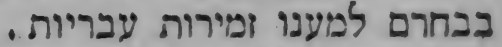 |
| 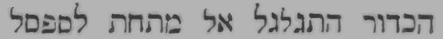 | 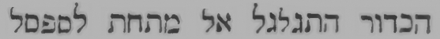 | 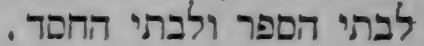 |
| 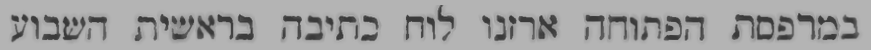 |  | 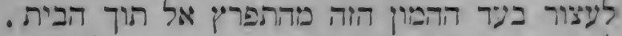 |
| 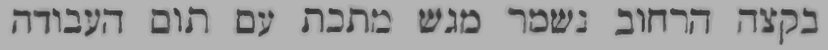 |  | 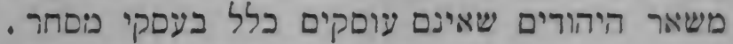 |
|  | 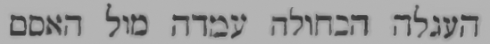 | 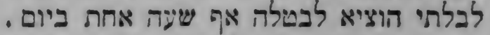 |

## Source-pitch page

[Gray-first page](assets/page-raw.png) · [Classical page](assets/page-smooth.png) · [Measurements and provenance](generation_manifest.json)

The synthetic images and authored labels are CC0. Real references carry their source rights. This gallery is for TRAIN/calibration. [Source release](https://huggingface.co/datasets/HeOCR/hebrew-ocr-vlm-train-v1/tree/6062adaba2e3f9ba3e01b527301f7b533bf11368)
