# Realism v3 · Photocopy and flatbed comparisons

Each row shows a clean synthetic control, the same Hebrew text after the v3
treatment, and a real reference crop. Open an image for the full crop. The
gallery has 20 comparisons: 16 photocopy, two documented flatbed, and two bound
scan crops for edge and spine cues.

[Photocopies](#photocopies) · [Flatbed and bound scans](#flatbed-and-bound-scans)
· [Measurements](#what-changed-from-v2)

The sixteen photocopy examples are historical. TRAIN uses the approved
[LookScanned photocopy profile](../BW_PHOTOCOPY.md). Pairs 17–20 supply
the locked flatbed and bound presets.

## What changed from v2

V2 made platen scans too gray and used heavy black bands and screening on
every page. The v3 model fits paper and ink levels, clipped contrast, small
isolated dark components, a soft edge and any narrow contact fringe, residual
row banding, effective blur and page slope. It adjusts the fit after trial
renders so that coupled effects such as blur and tone remain comparable.
Round marks still vary: margin punch shapes are estimated from compact dark
components on the photocopies, while rings, diffuse stains and smaller soft
spots are added separately as preview styling.

These are medians measured at 640 px width. The three columns cover five v2
platen examples, sixteen real photocopy crops and the sixteen v3 treatments
fitted to those crops.

| Raster measurement | V2 platen | Real photocopies | V3 fitted |
| --- | ---: | ---: | ---: |
| Paper gray level, 0–255 | 219 | 255 | 255 |
| Ink floor, 0–255 | 15 | 63 | 65 |
| Ink below gray level 26 | 39% | 1% | 0% |
| Margin darkening, gray levels | 201 | 1 | 0 |
| Effective blur proxy, px | 0.87 | 0.64 | 0.70 |
| Row banding proxy, gray levels | 1.39 | 0.42 | 1.23 |
| Isolated dark candidates per megapixel | 100 | 712 | 1,026 |
| Median center skew | 0° | 0° | 0° |

The v3 photocopy crops still have too many dark candidates and stronger
banding than the reference medians. The two bound witnesses show a
margin-to-center slope difference of about 0.6–0.8°. That constrains the
local bend proxy. The archive copies have no matched untouched originals or
known copy generation count, so edge spread measures **effective blur**.
The slope also combines writing or layout slope with any actual page curl.

## References and reuse

The four reports are catalogued as photocopies of typescripts and marked
public domain. A Microtek 9800XL scanned the 1892 engineering plate. Its two
patches show texture and edge behavior. The two NYPL bound-volume scans
support the spine examples; the capture hardware is unreported. These are a
small reference set for appearance review. Every row records its source,
exact crop bounds, measurements and settings in the
[generation manifest](generation_manifest.json). The
[source ledger](sources.json) pins original bytes and rights evidence.

The authored text, synthetic images and original documentation in this
preview are dedicated under [CC0 1.0](https://creativecommons.org/publicdomain/zero/1.0/).
The real reference crops retain their source public-domain status.
[Existing font files](../../../src/hocrsyngen/data/synthetic/fonts) retain
their licenses. Synthetic views use only measured statistics from the
reference crops. All authored Hebrew lines are the intact, previously
screened v2 text.

## Photocopies

| Pair | Clean control | V3 synthetic | Real reference crop |
| --- | --- | --- | --- |
| 01 | <a href="images/01-control.jpg"></a> | <a href="images/01-preview.jpg"></a> | <a href="images/01-reference.jpg"></a><br><a href="https://commons.wikimedia.org/wiki/File:Phase_I_DRD_Unit_resource_analysis_-_user_requirement_specifications_-_land_and_survey_records_%28IA_phaseidrdunitres1624unit%29.pdf">Source · p. 10</a> |
| 02 | <a href="images/02-control.jpg"></a> | <a href="images/02-preview.jpg"></a> | <a href="images/02-reference.jpg">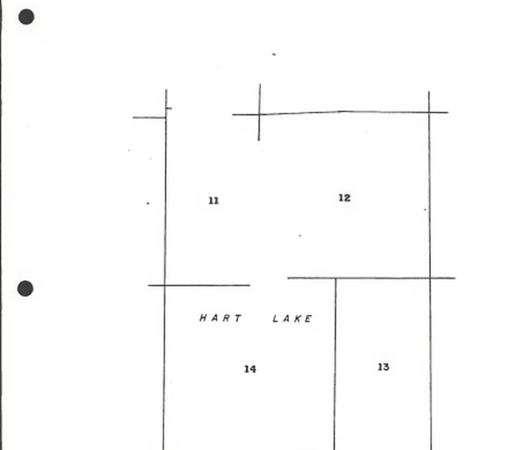</a><br><a href="https://commons.wikimedia.org/wiki/File:Phase_I_DRD_Unit_resource_analysis_-_user_requirement_specifications_-_land_and_survey_records_%28IA_phaseidrdunitres1624unit%29.pdf">Source · p. 20</a> |
| 03 | <a href="images/03-control.jpg"></a> | <a href="images/03-preview.jpg"></a> | <a href="images/03-reference.jpg">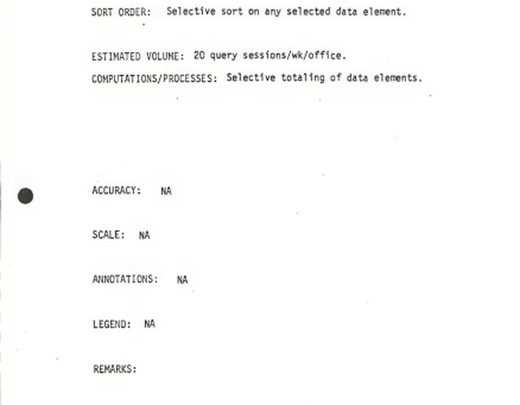</a><br><a href="https://commons.wikimedia.org/wiki/File:Phase_I_DRD_Unit_resource_analysis_-_user_requirement_specifications_-_land_and_survey_records_%28IA_phaseidrdunitres1624unit%29.pdf">Source · p. 42</a> |
| 04 | <a href="images/04-control.jpg"></a> | <a href="images/04-preview.jpg"></a> | <a href="images/04-reference.jpg">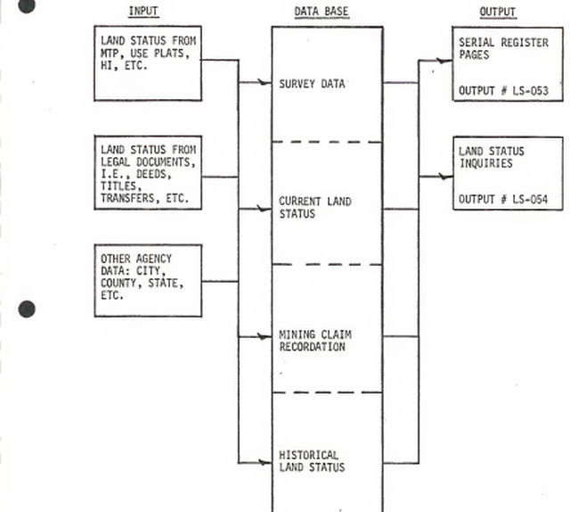</a><br><a href="https://commons.wikimedia.org/wiki/File:Phase_I_DRD_Unit_resource_analysis_-_user_requirement_specifications_-_land_and_survey_records_%28IA_phaseidrdunitres1624unit%29.pdf">Source · p. 74</a> |
| 05 | <a href="images/05-control.jpg"></a> | <a href="images/05-preview.jpg"></a> | <a href="images/05-reference.jpg"></a><br><a href="https://commons.wikimedia.org/wiki/File:Phase_I_DRD_Unit_resource_analysis_-_user_requirement_specifications_-_fire_%28IA_phaseidrdunitres1621unit%29.pdf">Source · p. 12</a> |
| 06 | <a href="images/06-control.jpg"></a> | <a href="images/06-preview.jpg"></a> | <a href="images/06-reference.jpg">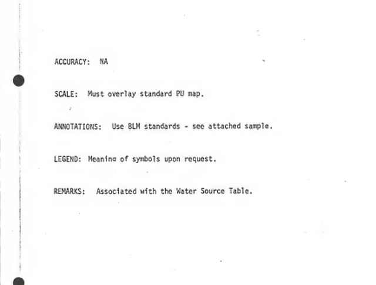</a><br><a href="https://commons.wikimedia.org/wiki/File:Phase_I_DRD_Unit_resource_analysis_-_user_requirement_specifications_-_fire_%28IA_phaseidrdunitres1621unit%29.pdf">Source · p. 17</a> |
| 07 | <a href="images/07-control.jpg"></a> | <a href="images/07-preview.jpg"></a> | <a href="images/07-reference.jpg">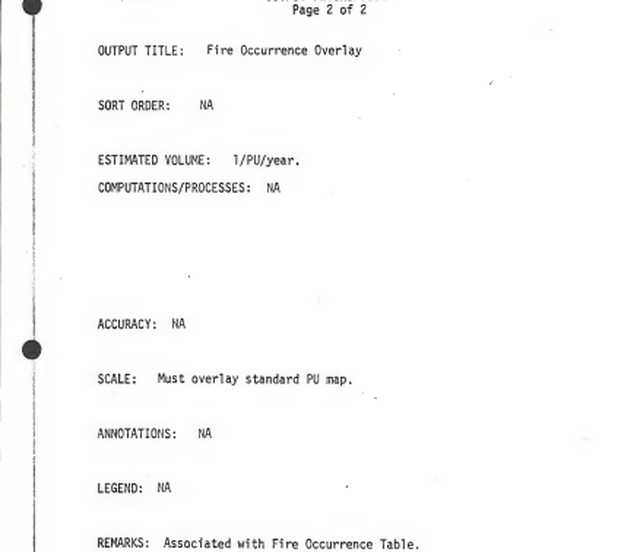</a><br><a href="https://commons.wikimedia.org/wiki/File:Phase_I_DRD_Unit_resource_analysis_-_user_requirement_specifications_-_fire_%28IA_phaseidrdunitres1621unit%29.pdf">Source · p. 27</a> |
| 08 | <a href="images/08-control.jpg"></a> | <a href="images/08-preview.jpg"></a> | <a href="images/08-reference.jpg">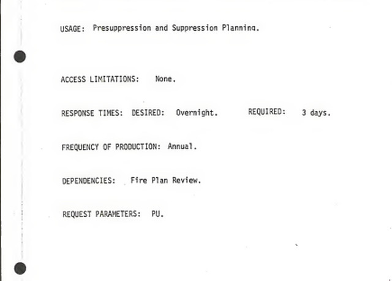</a><br><a href="https://commons.wikimedia.org/wiki/File:Phase_I_DRD_Unit_resource_analysis_-_user_requirement_specifications_-_fire_%28IA_phaseidrdunitres1621unit%29.pdf">Source · p. 36</a> |
| 09 | <a href="images/09-control.jpg"></a> | <a href="images/09-preview.jpg"></a> | <a href="images/09-reference.jpg"></a><br><a href="https://commons.wikimedia.org/wiki/File:Fay_Hill_revisited_-_an_addendum_to%2C_Archaeological_test_excavation_at_the_Fay_Hill_Site%2C_CA-SHA-1481%2C_Shasta_County%2C_California%2C_1984_%28IA_fayhillrevisited00farb%29.pdf">Source · p. 8</a> |
| 10 | <a href="images/10-control.jpg"></a> | <a href="images/10-preview.jpg"></a> | <a href="images/10-reference.jpg"></a><br><a href="https://commons.wikimedia.org/wiki/File:Fay_Hill_revisited_-_an_addendum_to%2C_Archaeological_test_excavation_at_the_Fay_Hill_Site%2C_CA-SHA-1481%2C_Shasta_County%2C_California%2C_1984_%28IA_fayhillrevisited00farb%29.pdf">Source · p. 11</a> |
| 11 | <a href="images/11-control.jpg"></a> | <a href="images/11-preview.jpg"></a> | <a href="images/11-reference.jpg">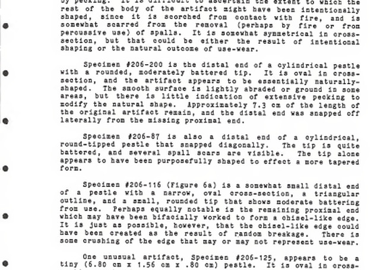</a><br><a href="https://commons.wikimedia.org/wiki/File:Fay_Hill_revisited_-_an_addendum_to%2C_Archaeological_test_excavation_at_the_Fay_Hill_Site%2C_CA-SHA-1481%2C_Shasta_County%2C_California%2C_1984_%28IA_fayhillrevisited00farb%29.pdf">Source · p. 17</a> |
| 12 | <a href="images/12-control.jpg"></a> | <a href="images/12-preview.jpg"></a> | <a href="images/12-reference.jpg">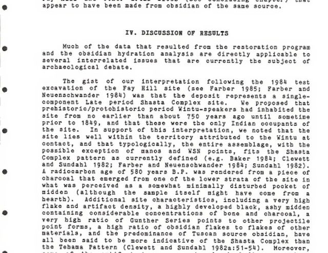</a><br><a href="https://commons.wikimedia.org/wiki/File:Fay_Hill_revisited_-_an_addendum_to%2C_Archaeological_test_excavation_at_the_Fay_Hill_Site%2C_CA-SHA-1481%2C_Shasta_County%2C_California%2C_1984_%28IA_fayhillrevisited00farb%29.pdf">Source · p. 23</a> |
| 13 | <a href="images/13-control.jpg"></a> | <a href="images/13-preview.jpg"></a> | <a href="images/13-reference.jpg">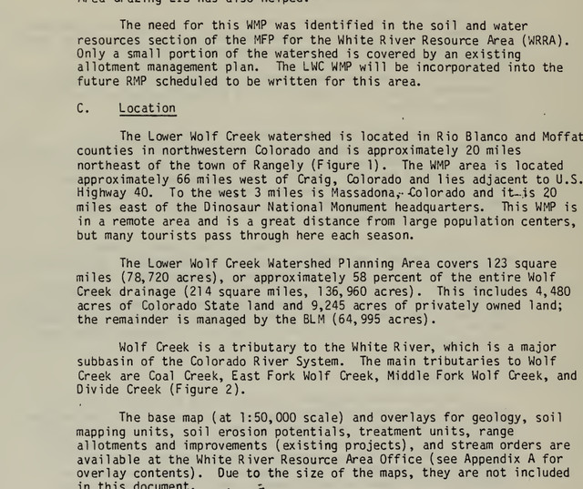</a><br><a href="https://commons.wikimedia.org/wiki/File:Lower_Wolf_Creek_watershed_management_plan_%28IA_lowerwolfcreek0940unit%29.pdf">Source · p. 12</a> |
| 14 | <a href="images/14-control.jpg"></a> | <a href="images/14-preview.jpg"></a> | <a href="images/14-reference.jpg">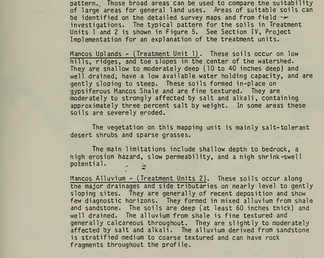</a><br><a href="https://commons.wikimedia.org/wiki/File:Lower_Wolf_Creek_watershed_management_plan_%28IA_lowerwolfcreek0940unit%29.pdf">Source · p. 23</a> |
| 15 | <a href="images/15-control.jpg"></a> | <a href="images/15-preview.jpg"></a> | <a href="images/15-reference.jpg"></a><br><a href="https://commons.wikimedia.org/wiki/File:Lower_Wolf_Creek_watershed_management_plan_%28IA_lowerwolfcreek0940unit%29.pdf">Source · p. 28</a> |
| 16 | <a href="images/16-control.jpg"></a> | <a href="images/16-preview.jpg"></a> | <a href="images/16-reference.jpg">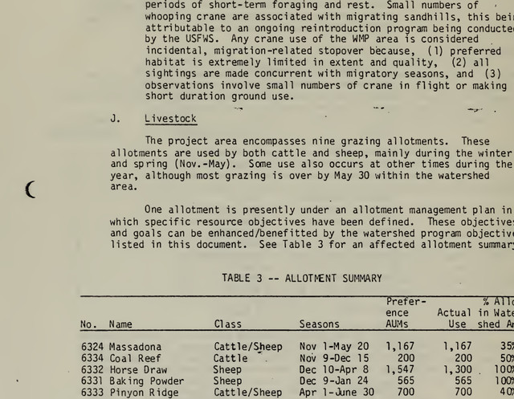</a><br><a href="https://commons.wikimedia.org/wiki/File:Lower_Wolf_Creek_watershed_management_plan_%28IA_lowerwolfcreek0940unit%29.pdf">Source · p. 38</a> |

## Flatbed and bound scans

| Pair | Clean control | V3 synthetic | Real reference crop |
| --- | --- | --- | --- |
| 17 | <a href="images/17-control.jpg"></a> | <a href="images/17-preview.jpg"></a> | <a href="images/17-reference.jpg">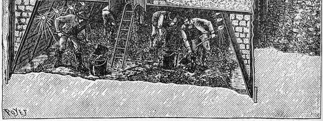</a><br><a href="https://commons.wikimedia.org/wiki/File:Paris_Eiffel_Tower_Caissons_for_foundations.jpg">Source</a> |
| 18 | <a href="images/18-control.jpg"></a> | <a href="images/18-preview.jpg"></a> | <a href="images/18-reference.jpg">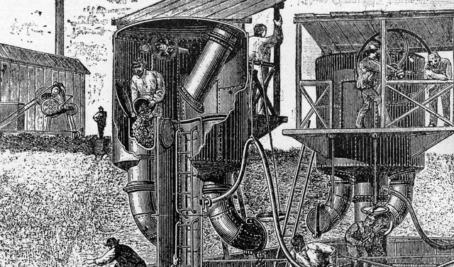</a><br><a href="https://commons.wikimedia.org/wiki/File:Paris_Eiffel_Tower_Caissons_for_foundations.jpg">Source</a> |
| 19 | <a href="images/19-control.jpg"></a> | <a href="images/19-preview.jpg"></a> | <a href="images/19-reference.jpg"></a><br><a href="https://commons.wikimedia.org/wiki/File:Letterpress_copybook%2C_1870-1874_%28NYPL_b11652246-3966645%29.tiff">Source</a> |
| 20 | <a href="images/20-control.jpg"></a> | <a href="images/20-preview.jpg"></a> | <a href="images/20-reference.jpg"></a><br><a href="https://commons.wikimedia.org/wiki/File:Letterpress_copybook%2C_1870-1874_%28NYPL_b11652246-3966590%29.tiff">Source</a> |

## Reproduce

Download the seven exact files listed in [sources.json](sources.json) under
their recorded filenames. The builder checks their SHA-256 before reading
them. From the repo root, use the Scanifier experiment dependencies plus
Pillow 11.3.0 with libraqm, pypdfium2 5.7.1, NumPy 2.3.1 and OpenCV 4.13.0.

```sh
PYTHONPATH=. python experiments/scanifier_v2/realism_v3_preview/build_preview.py \
  --sources /path/to/reference-files --output /path/to/new/replay/images
```
